<!-- Generated by .github/scripts/render_profile.py: edit content there, not here. -->

<a href="https://jacobelcharar.dev"><picture><source media="(max-width: 600px) and (prefers-color-scheme: light)" srcset="./assets/expressive/hero-m-light.svg"><source media="(max-width: 600px)" srcset="./assets/expressive/hero-m-dark.svg"><source media="(prefers-color-scheme: light)" srcset="./assets/expressive/hero-d-light.svg"></picture></a>

<a href="https://jacobelcharar.dev"><picture><source media="(prefers-color-scheme: light)" srcset="./assets/expressive/btn-portfolio-light.svg"></picture></a>&nbsp;<a href="https://www.linkedin.com/in/jacob-elcharar-b9ba3a3a1/"><picture><source media="(prefers-color-scheme: light)" srcset="./assets/expressive/btn-linkedin-light.svg"></picture></a>&nbsp;<a href="mailto:jacobel640@gmail.com"><picture><source media="(prefers-color-scheme: light)" srcset="./assets/expressive/btn-email-light.svg"></picture></a>

 

<picture><source media="(max-width: 600px) and (prefers-color-scheme: light)" srcset="./assets/expressive/stack-m-light.svg"><source media="(max-width: 600px)" srcset="./assets/expressive/stack-m-dark.svg"><source media="(prefers-color-scheme: light)" srcset="./assets/expressive/stack-d-light.svg"></picture>

<picture><source media="(max-width: 600px) and (prefers-color-scheme: light)" srcset="./assets/expressive/section-02-m-light.svg"><source media="(max-width: 600px)" srcset="./assets/expressive/section-02-m-dark.svg"><source media="(prefers-color-scheme: light)" srcset="./assets/expressive/section-02-d-light.svg"></picture>

<a href="https://jacobelcharar.dev/projects/minim4you-waba-wix/"><picture><source media="(max-width: 600px) and (prefers-color-scheme: light)" srcset="./assets/expressive/project-minim4you-m-light.svg"><source media="(max-width: 600px)" srcset="./assets/expressive/project-minim4you-m-dark.svg"><source media="(prefers-color-scheme: light)" srcset="./assets/expressive/project-minim4you-d-light.svg"></picture></a> <a href="https://jacobelcharar.dev/projects/minim4you-waba-wix/"><picture><source media="(max-width: 600px) and (prefers-color-scheme: light)" srcset="./assets/expressive/action-minim4you-0-m-light.svg"><source media="(max-width: 600px)" srcset="./assets/expressive/action-minim4you-0-m-dark.svg"><source media="(prefers-color-scheme: light)" srcset="./assets/expressive/action-minim4you-0-d-light.svg"></picture></a>

<a href="https://jacobelcharar.dev/projects/files/"><picture><source media="(max-width: 600px) and (prefers-color-scheme: light)" srcset="./assets/expressive/project-files-m-light.svg"><source media="(max-width: 600px)" srcset="./assets/expressive/project-files-m-dark.svg"><source media="(prefers-color-scheme: light)" srcset="./assets/expressive/project-files-d-light.svg"></picture></a> <a href="https://jacobelcharar.dev/projects/files/"><picture><source media="(max-width: 600px) and (prefers-color-scheme: light)" srcset="./assets/expressive/action-files-0-m-light.svg"><source media="(max-width: 600px)" srcset="./assets/expressive/action-files-0-m-dark.svg"><source media="(prefers-color-scheme: light)" srcset="./assets/expressive/action-files-0-d-light.svg"></picture></a><a href="https://github.com/jacobel640/Files-legacy"><picture><source media="(max-width: 600px) and (prefers-color-scheme: light)" srcset="./assets/expressive/action-files-1-m-light.svg"><source media="(max-width: 600px)" srcset="./assets/expressive/action-files-1-m-dark.svg"><source media="(prefers-color-scheme: light)" srcset="./assets/expressive/action-files-1-d-light.svg"></picture></a>

<a href="https://jacobelcharar.dev/projects/taskflow/"><picture><source media="(max-width: 600px) and (prefers-color-scheme: light)" srcset="./assets/expressive/project-taskflow-m-light.svg"><source media="(max-width: 600px)" srcset="./assets/expressive/project-taskflow-m-dark.svg"><source media="(prefers-color-scheme: light)" srcset="./assets/expressive/project-taskflow-d-light.svg"></picture></a> <a href="https://jacobelcharar.dev/projects/taskflow/"><picture><source media="(max-width: 600px) and (prefers-color-scheme: light)" srcset="./assets/expressive/action-taskflow-0-m-light.svg"><source media="(max-width: 600px)" srcset="./assets/expressive/action-taskflow-0-m-dark.svg"><source media="(prefers-color-scheme: light)" srcset="./assets/expressive/action-taskflow-0-d-light.svg"></picture></a><a href="https://github.com/jacobel640/TaskFlow"><picture><source media="(max-width: 600px) and (prefers-color-scheme: light)" srcset="./assets/expressive/action-taskflow-1-m-light.svg"><source media="(max-width: 600px)" srcset="./assets/expressive/action-taskflow-1-m-dark.svg"><source media="(prefers-color-scheme: light)" srcset="./assets/expressive/action-taskflow-1-d-light.svg"></picture></a>

<a href="https://jacobelcharar.dev/projects/gio-manetti/"><picture><source media="(max-width: 600px) and (prefers-color-scheme: light)" srcset="./assets/expressive/project-gio-manetti-m-light.svg"><source media="(max-width: 600px)" srcset="./assets/expressive/project-gio-manetti-m-dark.svg"><source media="(prefers-color-scheme: light)" srcset="./assets/expressive/project-gio-manetti-d-light.svg"></picture></a> <a href="https://jacobelcharar.dev/projects/gio-manetti/"><picture><source media="(max-width: 600px) and (prefers-color-scheme: light)" srcset="./assets/expressive/action-gio-manetti-0-m-light.svg"><source media="(max-width: 600px)" srcset="./assets/expressive/action-gio-manetti-0-m-dark.svg"><source media="(prefers-color-scheme: light)" srcset="./assets/expressive/action-gio-manetti-0-d-light.svg"></picture></a>

<picture><source media="(max-width: 600px) and (prefers-color-scheme: light)" srcset="./assets/expressive/telemetry-m-light.svg"><source media="(max-width: 600px)" srcset="./assets/expressive/telemetry-m-dark.svg"><source media="(prefers-color-scheme: light)" srcset="./assets/expressive/telemetry-d-light.svg"></picture>

<picture><source media="(max-width: 600px) and (prefers-color-scheme: light)" srcset="./assets/expressive/footer-m-light.svg"><source media="(max-width: 600px)" srcset="./assets/expressive/footer-m-dark.svg"><source media="(prefers-color-scheme: light)" srcset="./assets/expressive/footer-d-light.svg"></picture>
