<!-- Images are SVGs in this repo, rendered daily from live GitHub data by .github/scripts/render_profile.py -->

### 4 years of shipping real-world systems — from low-level Android OS internals to resilient event-driven cloud integrations.

&nbsp;&nbsp;

 

  
  
  

 

&nbsp;

  
  

