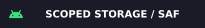
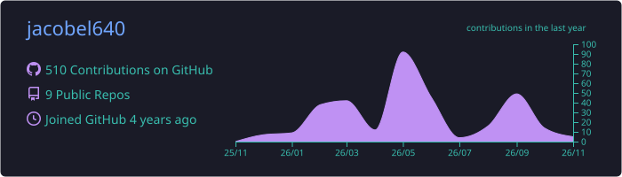
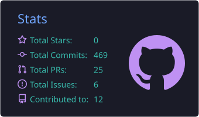
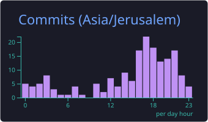
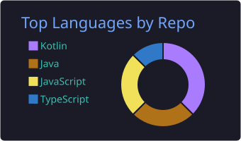
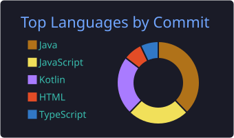

<!-- ═══════════════════════════════ HERO ═══════════════════════════════ -->
<p align="center">
  
</p>

<p align="center">
  <a href="https://github.com/jacobel640">
    
  </a>
</p>

<p align="center">
  <a href="https://www.linkedin.com/in/jacob-elcharar-b9ba3a3a1/"></a>
  <a href="mailto:jacobel640@gmail.com"></a>
  <a href="https://github.com/jacobel640/Jacobs-Portfolio"></a>
</p>

<br />

<!-- ═══════════════════════════════ ABOUT ═══════════════════════════════ -->
<table>
<tr>
<td width="56%" valign="top">

### `> whoami`

**4 years** shipping production software end-to-end — from a memory-safe Android I/O engine
to client-facing WhatsApp commerce systems running on real customer traffic.

I own problems from spec to production: architecture, implementation, deployment,
and the 2 a.m. edge cases nobody wrote a ticket for.

- 📱 **Core:** Native Android — Kotlin, Jetpack Compose, Coroutines/Flow, Scoped Storage & SAF
- 🧠 **Expanding into:** Fullstack GenAI — Next.js, TypeScript, LLM orchestration, agentic workflows
- 🔌 **Delivering:** independent client automations — webhooks, rate limits, state reconciliation
- 🎯 **Optimizing for:** zero UI jank, deterministic systems, boring-in-production code

</td>
<td width="44%" valign="top">

```kotlin
data class Engineer(
    val name: String = "Jacob Elcharar",
    val yearsShipping: Int = 4,
    val core: List<String> = listOf(
        "Kotlin", "Jetpack Compose",
        "Coroutines/Flow", "Scoped Storage"
    ),
    val expanding: List<String> = listOf(
        "Next.js", "TypeScript",
        "LLM Orchestration", "Agents"
    ),
    val mode: String = "end-to-end ownership",
)

fun main() = Engineer().let {
    println("Main thread is sacred.")
}
```

</td>
</tr>
</table>

<!-- ═══════════════════════════════ TECH GRID ═══════════════════════════════ -->
<h2 align="center">🧰 Tech Arsenal</h2>

<table align="center">
<tr>
<td align="center" width="25%"><b>📱 Mobile / OS</b></td>
<td align="center" width="25%"><b>🌐 Web / Backend</b></td>
<td align="center" width="25%"><b>🧠 GenAI</b></td>
<td align="center" width="25%"><b>🔌 Integrations / Ops</b></td>
</tr>
<tr>
<td align="center" valign="top">
<br />
<br />
<br />
<br />
<br />
<br />

</td>
<td align="center" valign="top">
<br />
<br />
<br />
<br />
<br />
<br />
<br />
<br />

</td>
<td align="center" valign="top">
<br />
<br />
<br />
<br />
<br />

</td>
<td align="center" valign="top">
<br />
<br />
<br />
<br />
<br />
<br />

</td>
</tr>
</table>

<!-- ═══════════════════════════════ FLAGSHIP PROJECTS ═══════════════════════════════ -->
<h2 align="center">🚀 Flagship Systems</h2>

<table>
<tr>
<td width="33%" valign="top">

<h3 align="center">💬 Minim4You · WABA × Wix</h3>

<p align="center">
  
</p>

Real-world client system that turns **WhatsApp into a storefront** — WhatsApp Business API
wired into Wix e-commerce for live order management and conversation tracking.

**Architecture**
- Event-driven, idempotent **webhook ingestion**
- **Rate-limit aware** outbound messaging with retry/backoff
- **State reconciliation** between chat sessions and Wix orders
- Live in production with real customers

<p>
  
  
  
  
</p>

<sub>🔒 Private client code — architecture walkthrough on request.</sub>

</td>
<td width="33%" valign="top">

<h3 align="center">📁 Files · Android Engine</h3>

<p align="center">
  
</p>

Deep native file-management engine for Android — storage analyzer, archive viewer,
smart categories and a built-in audio player, built for **API 24 → 36**.

**Architecture**
- **Scoped Storage / SAF** across internal & SD-card volumes
- Structured concurrency — **all I/O off the main thread**, zero UI jank
- **Memory-safe streaming I/O** for huge directories & archives
- Modular Gradle build (`core/*`, `build-logic`) + macrobenchmarks

<p>
  
  
  
  
</p>

<sub>🔒 Next-gen engine is private · <a href="https://github.com/jacobel640/Files-legacy">public v1 →</a></sub>

</td>
<td width="33%" valign="top">

<h3 align="center">🛍️ GIO MANETTI · Commerce</h3>

<p align="center">
  
</p>

Premium fashion e-commerce platform for an established brand — **Hebrew-first (RTL)**,
high-traffic, high-visual-fidelity, built as a typed monorepo.

**Architecture**
- **Next.js App Router** storefront + **GraphQL BFF** + headless commerce service
- Money as **integer minor units** — no floating point, ever
- **Zod-validated** at every boundary (HTTP, queue, webhook, form)
- Shared `contracts` / `money` / `tokens` / `ui` packages

<p>
  
  
  
  
</p>

<sub>🔒 In active development — milestone demo on request.</sub>

</td>
</tr>
</table>

<details>
<summary><b>📂 More public work</b></summary>
<br />

| Project | What it is | Stack |
| --- | --- | --- |
| [**TaskFlow**](https://github.com/jacobel640/TaskFlow) | Clean, modern Android task manager | Kotlin · Compose |
| [**StatusSaver**](https://github.com/jacobel640/StatusSaver) | Save & manage WhatsApp statuses — Material 3, Clean Architecture | Kotlin · Compose |
| [**Files-legacy**](https://github.com/jacobel640/Files-legacy) | Public v1 of the Files engine | Kotlin · Android |
| [**antigravity-remote-control**](https://github.com/jacobel640/antigravity-remote-control) | Remote control companion for an agentic IDE | Android |

</details>

<!-- ═══════════════════════════════ PRINCIPLES ═══════════════════════════════ -->
<h2 align="center">🧭 Engineering Principles</h2>

<table align="center">
<tr>
<td align="center" width="25%">⚡<br /><b>Main thread is sacred</b><br /><sub>I/O, parsing and network never block a frame.</sub></td>
<td align="center" width="25%">🛡️<br /><b>Validate every boundary</b><br /><sub>Untrusted input stops at the edge — typed, or rejected.</sub></td>
<td align="center" width="25%">🔁<br /><b>Idempotent by default</b><br /><sub>Webhooks retry. Systems must not double-charge.</sub></td>
<td align="center" width="25%">📦<br /><b>Own it end-to-end</b><br /><sub>Spec → code → deploy → on-call. No hand-offs.</sub></td>
</tr>
</table>

<!-- ═══════════════════════════════ STATS ═══════════════════════════════ -->
<h2 align="center">📊 GitHub Analytics</h2>

<!-- Cards are generated daily by .github/workflows/profile-cards.yml and served from this repo (no third-party uptime dependency). -->
<p align="center">
  
</p>

<p align="center">
  
  
</p>

<p align="center">
  
  
</p>

<p align="center">
  
</p>

<!-- ═══════════════════════════════ FOOTER ═══════════════════════════════ -->
<p align="center">
  <b>Open to Senior Android & Fullstack GenAI roles</b> — let's build something that survives production.
</p>

<p align="center">
  <a href="https://www.linkedin.com/in/jacob-elcharar-b9ba3a3a1/"></a>
  <a href="mailto:jacobel640@gmail.com"></a>
  <a href="https://github.com/jacobel640/Jacobs-Portfolio"></a>
</p>


